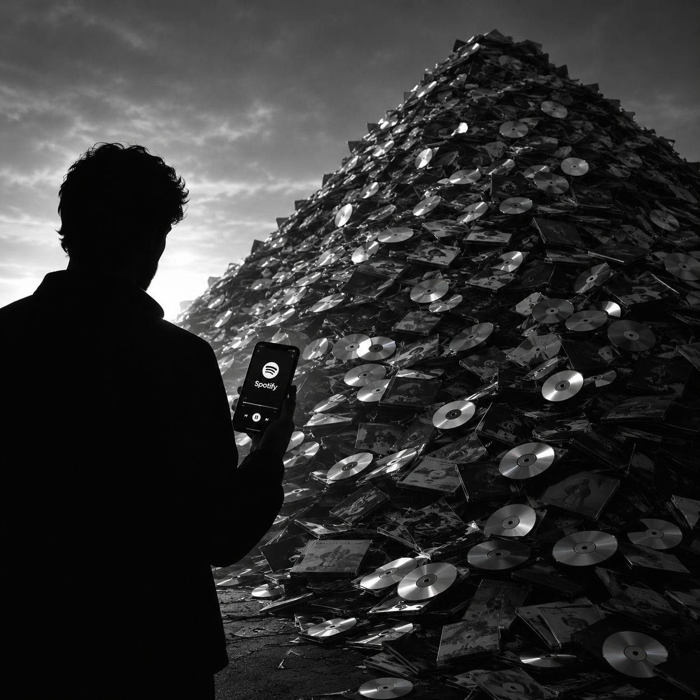

# Spotify killed the CD. Claude Code is coming for your apps

*(Image generated by ChatGPT)*

## The Spotify moment

I’m a music guy. I bought a lot of records:

* Vinyl first (yes, I’m that old),
* Then CDs.

Classical, jazz, metal. I spent a fortune on them.

Then Spotify arrived. I ignored it at first. One day I needed a recent album I didn’t own, so I signed up.

I told myself:

* “Bah, my hi-fi sounds way better than Spotify. I’ll only use it for what I don’t have on CD.”
* And: “Plenty of my discs aren’t on Spotify, so I’ll keep using my CD player.”

Then Bluetooth showed up, and it got harder to ignore. Then the sound got better. Then the catalogue got bigger.

Then one day it hit me: and it had been staring me in the face the whole time:

* “Crap. All those CDs are useless. I spent thousands of euros on something that’s now worth nothing... Because the world changed.”

## The Claude Code moment

Claude Code is triggering the exact same epiphany.

We’ve invested in a huge pile of software: millions to build, more to run, difficulty to maintain and make evolve.

And suddenly, Claude can rewrite most of it, often in a shape that fits how we actually work better than we ever did. Claude can maintain it. Claude can evolve it.

I look at all our IT landscape, at all the recurring costs they generate, and I say to myself:

* “Crap. All of it is worth nothing... Because the world changed.”

We can now rethink our entire IT, integrate everything, digitize every process. So much to do ahead of us!

## The verdict

Yes, subscriptions will balloon, inevitably.

But the world will never be the same as before.

Claude Code is for applications what Spotify was for CDs.

*(October 16 2026)*

