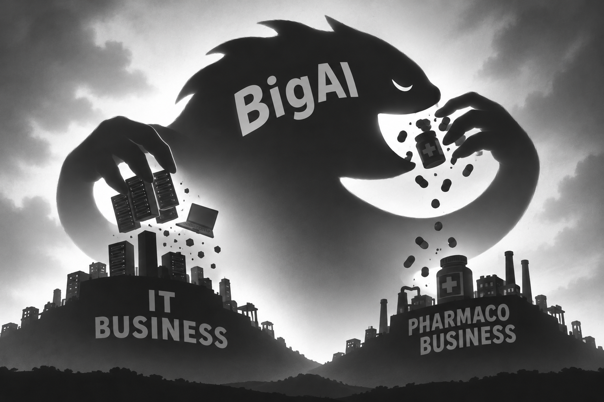

# The Only Way the AI Business Model Adds Up

*A slightly borderline theory*

*(Image generated by ChatGPT)*

The usual view of the big AI companies is that their business model can't last. They are borrowing huge sums, they invest in each other in circles (the chipmaker funds the lab, the lab buys the chips, the cloud provider does both), and they spend far more on compute than they bring in. On paper, it looks like a bubble waiting to burst.

But that view rests on a hidden assumption: *that the market stays the same size and shape*.

It treats AI as a new product added to the economy as it is today, and asks whether its revenues can ever pay for its costs. Looked at that way, they probably can't.

Things look very different if you look at how the market will move.

## The coming collapse

My hypothesis is this. Within about two years, the traditional IT services firms (consulting firms, system integrators, outsourcers) and the software vendors will see their market shrink by something like **three quarters**.

That would be the largest and fastest industrial collapse we have ever seen. Earlier industries took decades to decline. This one could fall within a couple of budget cycles.

Put some numbers on it. Worldwide IT services are worth about **1.6 trillion dollars a year** (source Gartner). Assume, crudely, that AI wipes out three quarters of that: **$1.2 trillion** in spending that no longer goes to people billing by the day.

Now ask the question that matters: where does that money go?

Some of it goes back to the customers as savings. Not all of it, though.

Suppose companies are happy to see their IT costs **halved**, not cut by 75%. Their spending drops from $1.6T to $0.8T. Of that $0.8T, about $0.4T still goes to the services that survive. That leaves about **400 billion dollars a year** that could flow to the AI providers.

$400 billion is a lot of money in any market. It is enormous if it is shared between two or three companies.

## The real price of Claude Code

This view also gives a different way to price AI tools.

Today a tool like Claude Code is priced like a software subscription: some tens or hundreds of dollars per seat per month. But if it replaces part of a team that bills thousands of euros a day, its economic value has nothing to do with its price.

On this logic, coding agents are badly underpriced. Today's prices buy adoption, and the "real price" is whatever share of the vanished services budget the vendor can eventually claim.

## Doing the customer's job

So the destiny of the AI labs is to **do their customers' work** themselves, starting with software.

Scientists are already noticing this. Mathematicians, for example, watch models move into territory that used to be theirs alone.

But science doesn't pay much. Software does, because companies pay for it, every year, through budgets that already exist.

That is why software comes first. It is the most valuable target, and the one where the labs' own skills are strongest.

Software won't be the last. We are already seeing AI labs move into pharmaceutical research, where a single successful drug can earn billions of dollars a year. Again, the lab stops selling a tool to the industry and starts competing for the industry's own output.

## A model that can't speak its name

This model has an obvious problem: **it can't be stated openly**.

"*We intend to absorb three quarters of our customers' suppliers, and eventually some of our customers*" is not a slide you show at a partner conference. It is too aggressive. Regulators, customers and the public would push back.

Yet as far as I can see, it is the only route to economic balance. The current figures only make sense if they lead somewhere like this.

## The timing problem

The second problem is **timing**.

How long will it actually take to replace three quarters of the IT services market, or to profit from the software vendors' collapse?

Large organisations adopt slowly. Contracts run for years, legacy systems resist, and so do people. If the change takes eight years and not two, the debt and the cash burn come due well before the revenue arrives.

## Creative destruction, with a safety net

The big AI companies can do the maths as well as anyone. Given these numbers, they have only one rational strategy: a **predatory** one.

Or, to put it more politely in the language economists have used since Schumpeter, **creative destruction**. In that story, the destruction is not a side effect. It is where the profit comes from.

And if it goes wrong, if the timing slips and the money runs out, there is always Washington. A few well-timed defence and government contracts can carry a strategic industry through a hard patch. Such an industry is rarely allowed to fail.

*(November 09 2026)*

